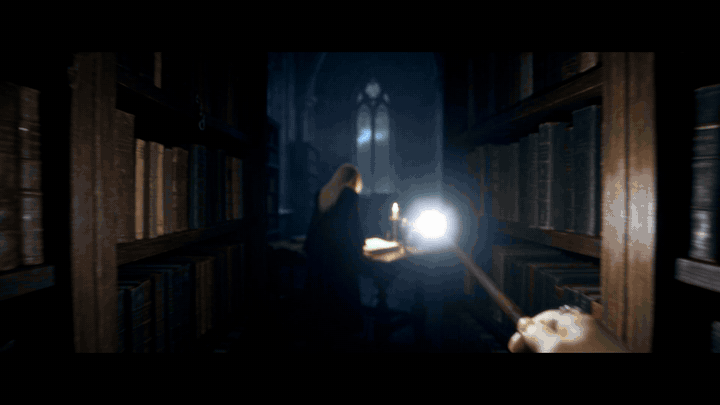

<div align="center">

# 马尔福桌面 · Miss Malfoy

**A living desktop companion — an interactive short drama set in the Slytherin common room.**

[](https://github.com/op7418/malfoy-desktop/releases)
[](LICENSE)
[](https://github.com/op7418/malfoy-desktop/releases)
[](#下载)
<br />
[](https://jimeng.jianying.com/)
[](https://threejs.org/)
[](https://www.electronjs.org/)
[](https://hyperframes.heygen.com/)
[](https://suno.com/)



**中文** · [English](#english)

</div>

一个用 **即梦 AI 短剧工作室** 做的沉浸式角色扮演加 AI 女友桌面 Demo。

你扮演刚转进斯莱特林的转学生，在午夜的禁书区遇见马尔福小姐。看完第一章之后，她会一直待在你桌面上的斯莱特林公共休息室里：
- **待机**：她看书、翻页、伸懒腰，晚上会睡着
- **互动**：点她，她会回你一句
- **好感度**：好感度越高，她对你的称呼越近，还会解锁新装扮和她的 CCD 合照
- **冥想盆**：看过的剧情随时可以回看

画面、角色和对白配音全部由即梦生成，音乐由 Suno 生成；剪辑、魔法转场特效和桌面程序是用代码做的。

- 架构与生成过程，事无巨细：**[技术文档.md](技术文档.md)**
- 素材说明：**[MEDIA.md](MEDIA.md)**
- 后续计划：**[TODO.md](TODO.md)**

## 下载

macOS 版到 [Releases](https://github.com/op7418/malfoy-desktop/releases) 下载，Windows 版去 Steam 创意工坊订阅：

- **macOS**：`Miss-Malfoy-mac-arm64.dmg`。仅支持 Apple Silicon，没有签名，第一次打开要**右键 → 打开**。打开后菜单栏会出现一个 🐍，选「和她互动…」进入可点击模式，按 Esc 回到壁纸模式。
- **Windows**：Wallpaper Engine 创意工坊，即将上线。要能点到她，需要在 Wallpaper Engine 的设置里打开「鼠标输入」。

## 仓库里有什么

这里只放代码。视频、图片、音乐、剧本和文章是我们自己的作品，不公开；安装包里已经带好了运行需要的素材。

```
├─ 共享资源/                三个项目共用的代码与字体
│  ├─ lib/magic.js          Three.js 魔法特效：飞路火焰、冥想盆、荧光闪烁、银墨书写、斯莱特林法阵
│  ├─ lib/hogwarts-ui.css   界面组件
│  ├─ lib/type-system.css   视频里的字体与排版
│  ├─ lib/fx.js             上一版特效（碎裂、银尘、粒子环），保留备查
│  └─ fonts/                Cormorant Garamond、Cinzel、DSEG7（均为 SIL OFL 1.1）
├─ 剪辑/                    剧情正片（HyperFrames 工程）
├─ 宣传片/                  宣传片（HyperFrames 工程）
├─ 桌面程序/
│  ├─ app/                  网页核心：播放引擎、剧情、好感度、相册、UI
│  ├─ mac/                  Electron 外壳与打包
│  ├─ wallpaper-engine/     Windows 版工程文件（其余内容从 app/ 拷贝）
│  └─ tools/                静止循环、图标生成脚本
└─ 工具/                    语音识别、响度母带、运动热图、安装包打包
```

从源码运行，需要按 [MEDIA.md](MEDIA.md) 里的路径和文件名自备素材：

```bash
# 桌面程序
cd 桌面程序/mac && npm install
npm start           # 开发运行（会先把 ../app 同步到 web/）
npm run dist        # 打包 dmg

# 视频（在 剪辑/ 或 宣传片/ 目录里）
npx hyperframes preview --background
npx hyperframes render -o renders/输出.mp4
../工具/master-loudness.sh renders/输出.mp4 renders/输出_master.mp4   # 母带：-15 LUFS / -1 dBTP
```

依赖：Node 22、ffmpeg 8、HyperFrames CLI 0.8.210、Electron 33.2.1、electron-builder 25.1.8、three.js 0.160.0、GSAP 3.14.2。语音识别另需 faster-whisper（Python venv，small.en / medium.en）。

## 制作

- 画面、角色、场景、对白配音：即梦 AI 短剧工作室
- 音乐：Suno（主题曲 Say Nothing Tonight、剧情配乐 Clockwork Hush、桌面 BGM Hush, Piano Alone）
- 剪辑、特效、桌面程序：HyperFrames、Three.js、GSAP、Electron

## 许可

- **代码**：[PolyForm Noncommercial 1.0.0](LICENSE)。可以学习、研究，也可以在非商业前提下修改和分发，**不能商用**；如需商用，请联系作者。
- **安装包里的素材**（视频、图片、音乐）：只用于个人体验，不授权再分发、二次剪辑或商用。
- **字体**：各自遵循 SIL Open Font License 1.1。

## 声明

这是一个非商业的同人创作。《哈利·波特》相关的人物、名称、世界观版权归原作者及华纳兄弟所有，本项目与他们没有任何关联，也没有得到授权。角色"马尔福小姐"是基于原作人物的性转二创，所有出场人物均已成年。请勿将本项目用于商业用途，也不要把它重新打包上架到应用商店或创意工坊。官方的 Windows 版只发布在作者自己的创意工坊页面。

---

<a id="english"></a>

## English

**Miss Malfoy** is an immersive role-play demo and AI desktop companion built with **Jimeng AI Short Drama Studio** (即梦 AI 短剧工作室).

You play a new transfer student sorted into Slytherin. Late one night in the Restricted Section, you run into Miss Malfoy. After Chapter One, she stays on your desktop, in the Slytherin common room:

- **Idle life**: she reads on the sofa, turns pages, stretches, and falls asleep after 11 PM. When she is still, the fire and the window light keep moving (4K).
- **Interaction**: click her and she answers back.
- **Branching story**: Chapter One, *The Restricted Section*, asks you to make a choice, and she reacts differently to each answer.
- **Affection**: as affection rises, the way she addresses you changes, and you unlock a home outfit, an armchair scene and a photo album of six Y2K-digicam snapshots.
- **Pensieve**: replay any memory you have already seen.

All footage, characters and voiced dialogue were generated with Jimeng; the music was made with Suno. Editing, the magic transitions (Floo flames, Pensieve swirl, Lumos flare, silver ink, a Slytherin sigil — all in Three.js) and the desktop app are code.

### Download

- **macOS** (Apple Silicon): `Miss-Malfoy-mac-arm64.dmg` from [Releases](https://github.com/op7418/malfoy-desktop/releases). The app is unsigned, so right-click → **Open** the first time. A 🐍 appears in the menu bar; choose "和她互动…" (Interact) to click around, and press Esc to go back to wallpaper mode.
- **Windows**: coming soon on the Wallpaper Engine Steam Workshop. Turn on **Mouse input** in Wallpaper Engine settings to interact with her.

### What is in this repo

Code only. The videos, images, music, script and article are our own work and are not published here; the installers already contain everything needed to run.

- `共享资源/` (shared): the Three.js magic effects library (`lib/magic.js`), UI kit and fonts
- `剪辑/` (film) and `宣传片/` (trailer): HyperFrames video projects
- `桌面程序/` (desktop app): the web core (playback engine, story, affection, album, UI), the Electron shell and the Wallpaper Engine project
- `工具/` (tools): speech recognition, loudness mastering, motion maps, release packaging

To run from source, put your own media at the paths listed in [MEDIA.md](MEDIA.md), then:

```bash
cd 桌面程序/mac && npm install
npm start        # run in development
npm run dist     # build the dmg
```

The full architecture and production process are documented (in Chinese) in [技术文档.md](技术文档.md).

### License

- **Code**: [PolyForm Noncommercial 1.0.0](LICENSE). You may study, modify and share it for noncommercial purposes. **Commercial use is not permitted**; contact the author for a commercial license.
- **Media in the installers** (video, images, music): for personal use only. Redistribution, re-editing and commercial use are not permitted.
- **Fonts**: SIL Open Font License 1.1.

### Disclaimer

This is a noncommercial fan project. Harry Potter characters, names and settings belong to J.K. Rowling and Warner Bros.; this project is not affiliated with or endorsed by them. "Miss Malfoy" is a gender-swapped fan interpretation, and all characters are adults. Please do not use this project commercially or repackage it for app stores or the Workshop. The official Windows version is published only on the author's own Workshop page.
